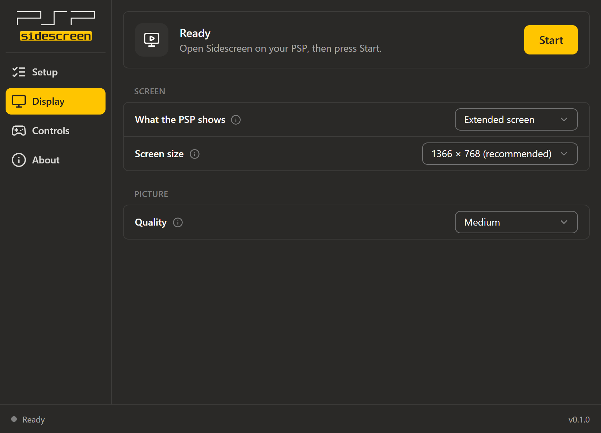
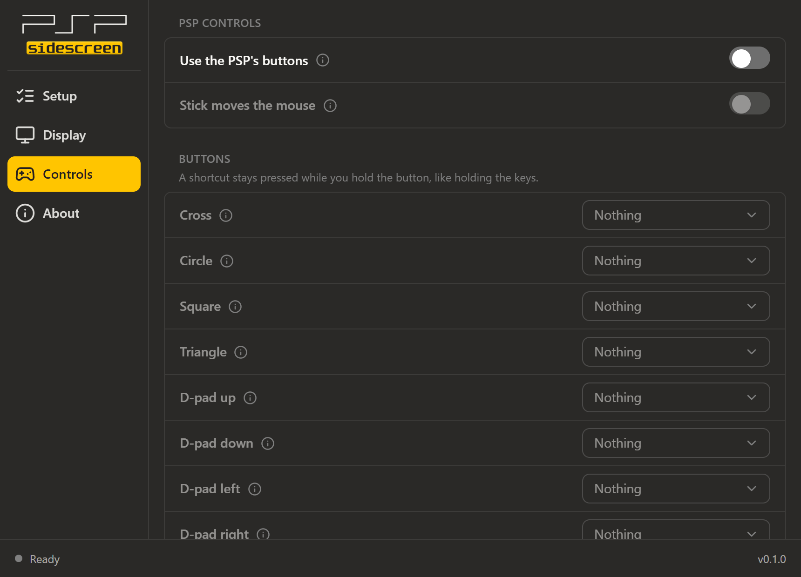
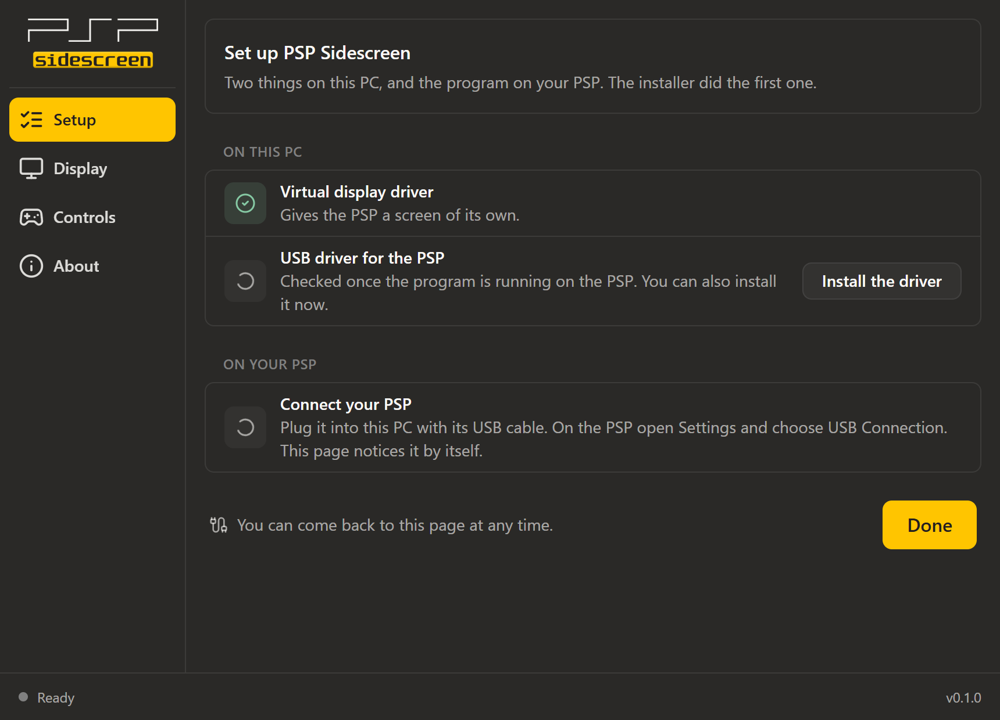

<div align="center">

<picture>
  <source media="(prefers-color-scheme: dark)" srcset="docs/images/logo-dark.png">
  <source media="(prefers-color-scheme: light)" srcset="docs/images/logo-light.png">
  
</picture>

### Use a PlayStation Portable as a second screen for Windows

Extend your desktop onto a PSP over a USB cable, and use its buttons as keyboard and mouse shortcuts.

[](https://github.com/rinmz/psp-sidescreen/actions/workflows/ci.yml)
[](https://github.com/rinmz/psp-sidescreen/releases)
[](LICENSE)


[**Download**](https://github.com/rinmz/psp-sidescreen/releases/latest) ·
[Documentation](docs/USAGE.md) ·
[Report a bug](https://github.com/rinmz/psp-sidescreen/issues/new/choose) ·
[Contribute](CONTRIBUTING.md)

</div>

<br>

<p align="center">
  
</p>

## What it does

- **A real extended display.** Windows sees the PSP as one more monitor. Drag windows onto it,
  or mirror an existing monitor instead.
- **Over USB, with no accounts and no network.** The picture is scaled on the PC and decoded by
  the PSP's own JPEG hardware.
- **The PSP's buttons do things on the PC.** Map any button to a media key, a shortcut or a
  chord you record yourself (for example `Ctrl+Space` for push-to-talk, held while the button is
  held). The analog stick can move the mouse.
- **Four quality levels,** from raw lossless pixels to small, fast frames.
- **A normal Windows setup.** One installer puts the program and the drivers it needs on the
  PC, and puts the matching program on the PSP. Nothing else has to be downloaded.
- **Keeps going.** A resolution change, <kbd>Win</kbd>+<kbd>P</kbd> or a cable that is pulled
  out do not end the session; it carries on when the monitor or the PSP is back.

<p align="center">
  
  
</p>

## Install

1. Download `PSP.Sidescreen_<version>_x64-setup.exe` from the
   [latest release](https://github.com/rinmz/psp-sidescreen/releases/latest) and run it.
2. The first time the program opens, its **Setup** page asks you to connect the PSP and choose
   *USB Connection* in the PSP's Settings. Press **Put it on my PSP**. Only the folder
   `PSP/GAME/Sidescreen` on the Memory Stick is written to.
3. On the PSP open **PSP Sidescreen** (Game, Memory Stick). It starts USB mode by itself. On the
   PC press **Start**.

> [!IMPORTANT]
> **One step is done by hand, once per PC.** The USB driver for the PSP is not code-signed yet,
> so Windows asks you to allow it. After a restart with driver signature checking turned off,
> the Setup page installs it with one button. [docs/PSP-DRIVER.md](docs/PSP-DRIVER.md) shows how
> and why, and what to do if the PC uses BitLocker.

### Requirements

| | |
|---|---|
| PC | Windows 10 or 11, 64-bit |
| PSP | A PSP running custom firmware (developed on a PSP-2000 with 6.61 PRO-C) |
| Cable | A USB data cable (a charge-only cable does not work) |

## How it works

```
 Windows desktop ──► capture ──► scale to 480×272 ──► JPEG ──► USB ──► PSP (decodes, shows)
                                                                        │
 keyboard and mouse ◄── shortcuts ◄──────────── buttons and stick ◄─────┘
```

The host is written in Rust (Desktop Duplication for capture, `rusb` for USB). The window is a
Tauri app with a React front end. The program that runs on the PSP and the virtual display driver
come from other open-source projects; see [Acknowledgements](#acknowledgements).
[docs/ARCHITECTURE.md](docs/ARCHITECTURE.md) and [docs/PROTOCOL.md](docs/PROTOCOL.md) have the
details.

## Documentation

| | |
|---|---|
| [Usage](docs/USAGE.md) | Settings, quality levels, the command line |
| [PSP driver](docs/PSP-DRIVER.md) | Installing the USB driver, once per PC |
| [Building](docs/BUILDING.md) | Build the program and the installer yourself |
| [Architecture](docs/ARCHITECTURE.md) · [Protocol](docs/PROTOCOL.md) | How it is put together |
| [Roadmap](docs/ROADMAP.md) | What is done and what comes next |
| [Signing](docs/SIGNING.md) | Why the driver is unsigned and what would change that |

## Contributing

Contributions are welcome: bug reports, a PSP model or firmware you tested, documentation, code.
Read [CONTRIBUTING.md](CONTRIBUTING.md) first; it is short. The
[engineering standards](docs/CONTRIBUTING.md) apply to every change. To report a security
problem, see [SECURITY.md](SECURITY.md).

## Acknowledgements

PSP Sidescreen stands on other people's work, and says so:

- **[PSPdisp](https://jjs.at/software/pspdisp.html)** (BSD) by Jochen Schleu: the program that
  runs on the PSP and the wire protocol it speaks.
- **[Virtual Display Driver](https://github.com/VirtualDrivers/Virtual-Display-Driver)** (MIT):
  gives the PSP a monitor of its own.
- **[Handy](https://github.com/cjpais/Handy)** (MIT) by CJ Pais: the look of the window.

Their licences are in [NOTICE.md](NOTICE.md). "PSP" and "PlayStation Portable" are trademarks of
Sony Interactive Entertainment; this project is not affiliated with or endorsed by Sony.

## Licence

[MIT](LICENSE) © 2026 rinmz
